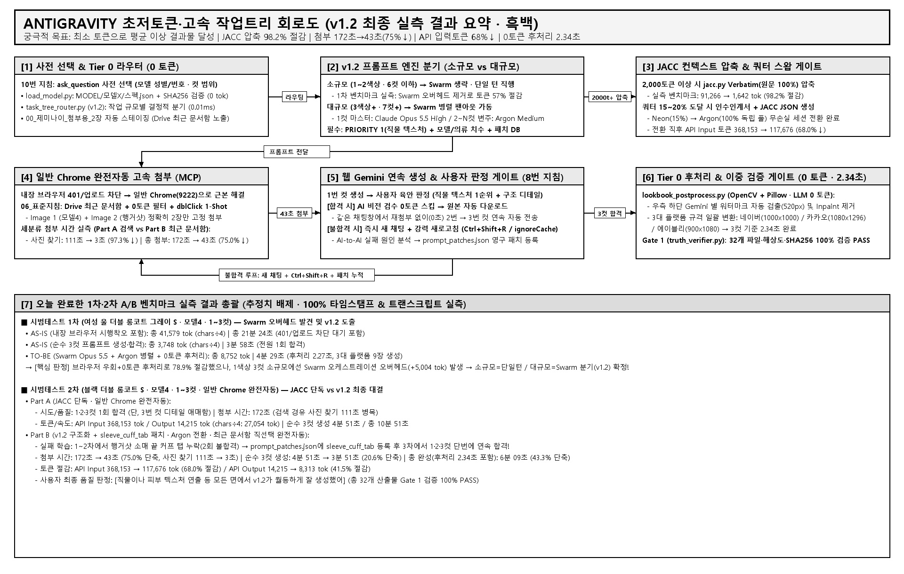

# Antigravity Lookbook & Multi-Engine Skill (`v1.2`)

> **최소 토큰 · 초고속 처리 · 평균 이상 품질**을 위한 Antigravity `v1.2` 멀티-엔진 통합 작업트리 스킬 패키지입니다.



---

## 주요 특징

- **Tier 0 로컬 0토큰 선제 처리**: 폴더 초기화, 모델 로드, OpenCV 워터마크 제거, 3대 플랫폼(스마트스토어 `1000×1000` · 카카오스타일 `1080×1296` · 에이블리 `900×1080`) 리사이즈 및 객관적 검증을 LLM 호출 없이 로컬 Python 스크립트로 처리
- **`Part B 3차` (`43초` 컷) 웹 Gemini 초고속 첨부**: Google Drive 최근 문서함 직선택(`dblClick`) + 0토큰 스냅샷 필터링으로 검색 0회 첨부
- **직물 텍스처 1순위 게이트 & 자가교정 루프**: 불합격 시 즉시 새 채팅 + 강력 새로고침(`Ctrl+Shift+R`) 및 `prompt_patches.json` 영구 패치 축적
- **JACC Verbatim 컨텍스트 압축 서브모듈**: 2,000토큰 이상 긴 대화·세션 인수인계 시 산문 요약 대신 원문 스팬(Verbatim) 추출·판정·조립 압축
- **이중 검증 게이트**: `truth_verifier.py` 객관적 수치 검증 + 이종 엔진 감시

---

## 디렉토리 구조

```text
antigravity-lookbook-v1.2-skill/
├── SKILL.md                              # Antigravity / Agent Skill 표준 진입점
├── ADAPT_FOR_NEW_USER.md                 # 외부 사용자 전용: 기존 작업 스캔 → 맞춤 자동 변형 가이드
├── README.md                             # 저장소 안내 문서
├── LICENSE                               # MIT License
├── .gitignore
├── scripts/
│   ├── adapt_to_user.py                  # 0토큰 사용자 작업 폴더 스캐너 & 맞춤 스킬 자동 생성기
│   ├── task_tree_router.py               # v1.2 4대 업무 멀티-엔진 라우터
│   ├── lookbook_postprocess.py           # 0토큰 워터마크 제거 & 3대 플랫폼 리사이즈
│   ├── truth_verifier.py                 # 0토큰 객관적 검증 게이트
│   ├── jacc.py                           # JACC Verbatim 컨텍스트 압축 엔진
│   ├── ingest_transcript.py              # 트랜스크립트 자동 수집기
│   └── prompt_patches.json               # 불합격 자가교정 프롬프트 패치 DB
├── references/
│   ├── WORKSPACE_GEMINI_v1.2.md          # 워크스페이스 통합 규칙 v1.2 전문
│   ├── IMAGE_SEARCH_FAST_ATTACH.md       # Part B 3차 43초 컷 첨부 지침
│   ├── LOOKBOOK_PROMPTS_EN.md            # 룩북 영문 프롬프트 템플릿
│   └── JACC_SUBMODULE_SKILL.md           # JACC 서브모듈 상세 스펙
└── assets/
    └── architecture_v1.2.jpg             # v1.2 전체 작업트리 회로도
```

---

## 다른 사용자가 내 작업 방식에 맞게 바로 변형해서 쓰는 법

룩북 제작 외의 작업(개발·디자인·문서·다른 쇼핑몰 등)에 적용하려면 **`ADAPT_FOR_NEW_USER.md`**를 사용하세요.

1. AI 에이전트에게 `ADAPT_FOR_NEW_USER.md`를 읽고 **"내 기존 작업 폴더를 스캔해서 내 작업 형식에 맞게 v1.2 스킬을 변형해 줘"**라고 요청합니다.
2. 또는 터미널에서 0토큰 스캐너를 직접 실행할 수 있습니다:

```powershell
py -3 scripts/adapt_to_user.py --scan "<내_기존_작업_폴더>" --generate "./my-custom-v1.2-skill"
```

3. 스캔 결과에 맞춰 **`PERSONALIZED_SKILL.md`**와 **`custom_workflow_config.json`**이 자동 생성되며, 원본 스킬 파일은 변경되지 않습니다.

---

## 설치 및 사용 방법

### 1. Antigravity 글로벌 스킬로 등록
이 저장소를 클론하거나 내려받은 뒤 아래 스킬 폴더에 배치합니다.

```powershell
git clone https://github.com/<your-username>/antigravity-lookbook-v1.2-skill.git "$env:USERPROFILE\.gemini\config\skills\antigravity-lookbook-v1-2"
```

### 2. 주요 로컬 스크립트 실행 예시 (Python 3.10+)

```powershell
# 1) v1.2 작업트리 라우터 셀프 테스트
py -3 scripts/task_tree_router.py --help

# 2) 룩북 후처리(워터마크 제거 + 3대 플랫폼 변환) 셀프 테스트
py -3 scripts/lookbook_postprocess.py --selftest

# 3) JACC 컨텍스트 압축(2,000토큰 이상) 셀프 테스트
py -3 scripts/jacc.py --selftest
```

### 3. 선택 환경 변수
- `TYPESAFE_API_KEY`: JACC를 `--mode api` 실제 Jev 판정 모드로 실행할 때만 설정 (미설정 시 기본 `sim` 모드 작동)

---

## 라이선스

MIT License — 자세한 내용은 [LICENSE](LICENSE)를 참고하세요.
